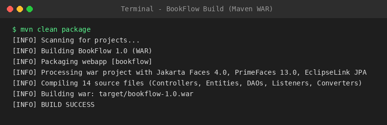

# BookFlow - Sistema de Gestao Bibliotecaria com Jakarta Faces e JPA

Sistema web para catalogacao e gerenciamento de acervo bibliotecario desenvolvido em Java utilizando a stack Jakarta EE 10, Jakarta Faces 4.0 (JSF), PrimeFaces 13, JPA (EclipseLink) e MySQL. O projeto implementa controle de autenticacao e autorizacao com regras de perfil (USER e ADMIN), validacoes customizadas com converters, consultas nomeadas (NamedQueries) e interceptacao de requisicoes via PhaseListeners do JSF.

Desenvolvido no IFSP para aprofundamento em arquitetura Jakarta EE corporativa.

## Tecnologias Utilizadas

* Java 17
* Jakarta EE 10 (Jakarta Faces 4.0, CDI, EJB, Bean Validation)
* PrimeFaces 13.0
* JPA 3.1 com provedor EclipseLink
* Servidor de Aplicacoes GlassFish 7
* Banco de Dados MySQL 8
* Apache Maven

## Recursos da Aplicacao

* Autenticacao com controle de sessao: LoginBean e gerenciamento de contexto do usuario conectado.
* Controle de acesso e autorizacao: interceptador de ciclo de vida JSF (PhaseListener) que restringe rotas administrativas (/admin/*) exclusivamente a usuarios com perfil ADMIN.
* Auditoria de requisicoes: registro em log do tempo de processamento de cada viewId por usuario autenticado.
* Consultas otimizadas com NamedQueries: operacoes de busca de usuarios, categorias e livros centralizadas em entidades de dominio e consumidas pelos DAOs.
* Conversores customizados (Converters):
  * Conversor de categoria para mapeamento bidirecional de objetos em componentes SelectOneMenu.
  * Conversor e formatador de ISBN.
* Telas responsivas com PrimeFaces: listagem dinamica de livros com filtros, paginacao, operacoes de cadastro, edicao e remocao restritas ao perfil bibliotecario.
* Carga automatica de dados: inicializador de dados executado no deploy para provisionamento de contas padrao e categorias iniciais.

## Estrutura do Codigo

* `src/main/java/br/edu/bookflow/model/`: Entidades JPA (Book, Category, User, Role) mapeadas com NamedQueries.
* `src/main/java/br/edu/bookflow/controller/`: Beans gerenciados (LoginBean, BookBean) responsaveis pela interacao com as visões JSF.
* `src/main/java/br/edu/bookflow/dao/`: Camada de persistencia com DAOs genericos e especificos, injecao de EntityManager e transacoes.
* `src/main/java/br/edu/bookflow/listener/`: Listeners de ciclo de vida (PhaseListener) para auditoria e controle de acesso.
* `src/main/java/br/edu/bookflow/converter/`: Conversores para integracao de entidades e formatos especiais com a interface web.
* `src/main/webapp/`: Paginas XHTML com componentes PrimeFaces, layouts, templates e recursos estaticos CSS.
* `sql/criar-banco.sql`: Script DDL para criacao do schema no MySQL.

## Configuracao do Ambiente

### 1. Criacao da Base de Dados
Execute o script `sql/criar-banco.sql` no MySQL 8 para criar a base `bookflow`. O EclipseLink realizara a criacao automatica das tabelas no primeiro deploy (`drop-and-create-tables`).

### 2. Driver e Pool JDBC no GlassFish 7
Copie o arquivo `mysql-connector-j-8.x.jar` para o diretorio de bibliotecas do GlassFish (`glassfish/domains/domain1/lib`).

Crie o connection pool e o recurso JDBC no GlassFish via utilitario `asadmin`:

```bash
asadmin create-jdbc-connection-pool --datasourceclassname com.mysql.cj.jdbc.MysqlDataSource --restype javax.sql.DataSource --property user=root:password=SUA_SENHA:serverName=localhost:portNumber=3306:databaseName=bookflow:useSSL=false:allowPublicKeyRetrieval=true:serverTimezone=UTC BookFlowPool

asadmin create-jdbc-resource --connectionpoolid BookFlowPool jdbc/bookflow
```

### 3. Compilacao do Projeto com Maven
Na raiz do projeto, execute:

```bash
mvn clean package
```

O artefato empacotado `target/bookflow-1.0.war` estara pronto para publicacao no GlassFish 7.

## Demonstracao do Build

Abaixo segue a captura da compilacao e empacotamento do pacote WAR com Maven:



## Acesso e Credenciais Padrao

Apos o deploy da aplicacao no GlassFish, acesse `http://localhost:8080/bookflow/`.

As seguintes contas sao provisionadas automaticamente na inicializacao:
* Leitor: `leitor@email.com` / Senha: `123456` (Perfil USER)
* Bibliotecario: `bibliotecario@email.com` / Senha: `123456` (Perfil ADMIN)
